# Layered mower PR screenshots and interaction plan

These captures use the production GUI and renderer with mocked REST/WebSocket
telemetry. They do not show a live mower or validate physical dimensions.
Hardware/Sensors preview edited settings; the map uses the running robot description.

## Current behavior

- Six graphite/mint shells: Rounded, Sculpted, Utility, Yardforce-inspired,
  RM1000-inspired and Worx-inspired. Choose once in Hardware, below the model selector.
- Each appearance pairs a chassis and dock. Existing styles share the standard
  station; Worx uses the side-charging station. There is no separate map dock selector.
- Hardware and Sensors show a docked illustration. Sensors opens transparent;
  the map always shows a solid shell, rear wheels, GPS and enabled LiDAR only.
- Disabled LiDAR artwork and editor handles disappear without losing its mount settings.
- Source bounds/physical frames exclude padding and preserve the real chassis rear
  across wheel cutouts. Wheels, blade and sensors scale independently.
- Dock footprint length/width and Dock Center X/Y are display-only settings.
  Zero X/Y uses the artwork registration: standard +0.220 m forward of the rear
  axle; Worx slatted-platform centre aligned with chassis centre. Operator adjustments
  are additive. Early test configurations that saved a nominal centre should reset
  X/Y to zero. Calibrated dock poses and navigation are unaffected.
- Solid setup previews use 70% dock opacity; transparent previews use 18%.
- Caster front/back position is an explicit numeric field with model starting values.
  Measurement tooltips and expanding mobile label rows are implemented.
- There is no separate stop-button overlay.

## Screenshot geometry

Illustrative fixture values in metres, not recommended physical installations.
Coordinates are forward/left/up from the rear axle. Sensor positions follow
the visible shell roof in the examples; generated shells are not CAD.

| Geometry | Yardforce 500 | Custom Utility | RM1000 | Shallow Worx |
| --- | --- | --- | --- | --- |
| Chassis L / W / H | .600 / .450 / .190 | .660 / .460 / .180 | .570 / .400 / .190 | .540 / .360 / .140 |
| Chassis centre X / bottom Z | .180 / -.050 | .180 / -.060 | .145 / -.050 | .160 / -.070 |
| Drive radius / width / centre track | .100 / .040 / .325 | .100 / .050 / .300 | .100 / .040 / .300 | .110 / .040 / .320 |
| Caster radius / centre track / X | .030 / .300 / .400 | .040 / .280 / .390 | .040 / .260 / .355 | .025 / .220 / .340 |
| GPS X / Y / Z | .150 / 0 / .148 | .160 / 0 / .130 | .115 / 0 / .145 | .200 / 0 / .080 |
| LiDAR X / Y / Z | .310 / 0 / .139 | .320 / 0 / .131 | .245 / 0 / .145 | Disabled |

The collection gallery is a presentation fixture using the production renderer,
not a new application screen. Its first five shells use a common 600 x 450 x 190 mm
envelope for comparison; Worx uses the shallower dimensions above. Its RM1000
chassis centre is .150 m. Sensors are omitted from the collection gallery.

Map screenshots use the same mock running URDF across both appearance choices,
showing that changing shell style does not change physical geometry. Docked views
give mower and station the same parked pose. Undocked views separate the poses
deliberately. A local plain basemap avoids publishing private garden/location data.

## Gallery

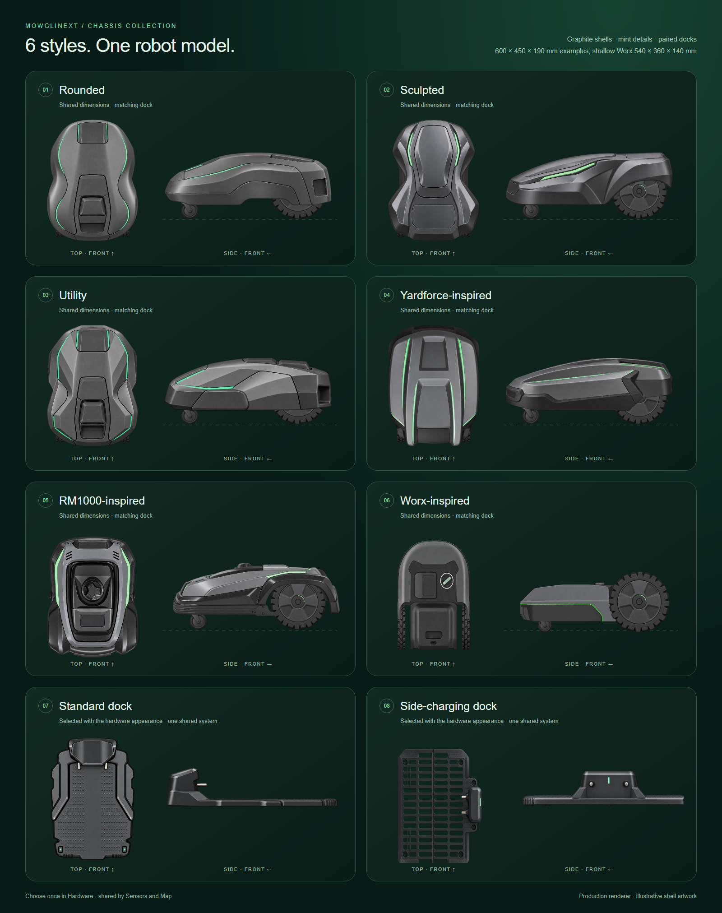

| Hardware | Transparent sensor editor |
| --- | --- |
|  | 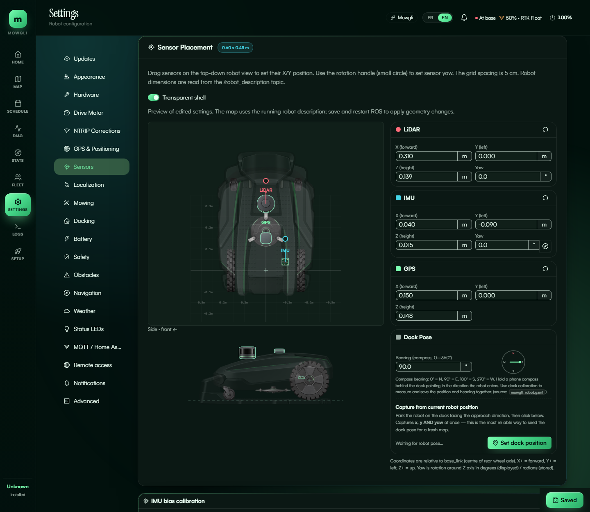 |
| 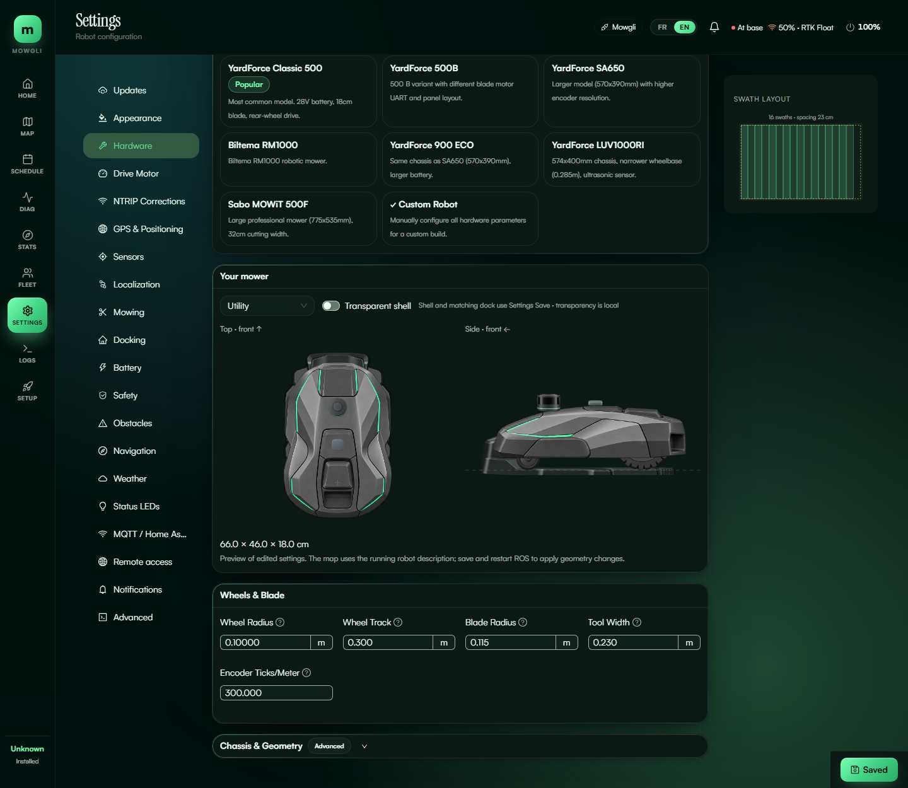 |  |
| 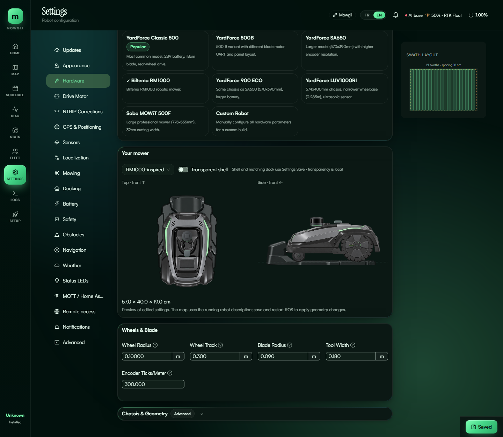 |  |
| 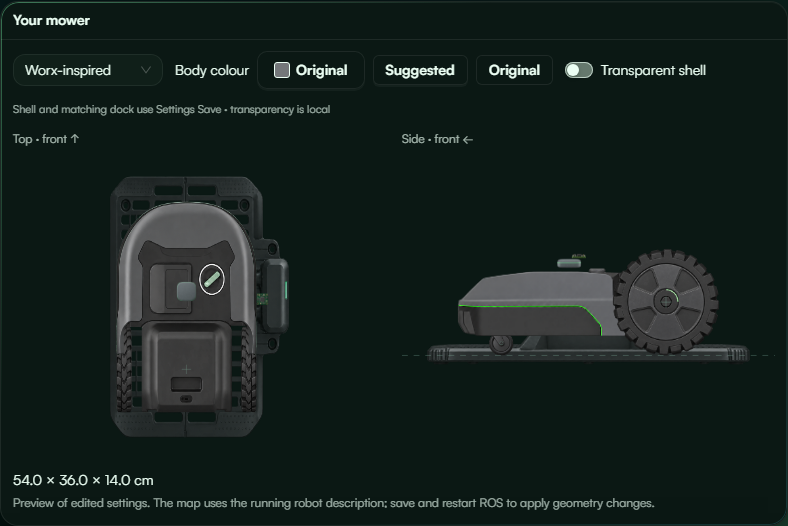 | 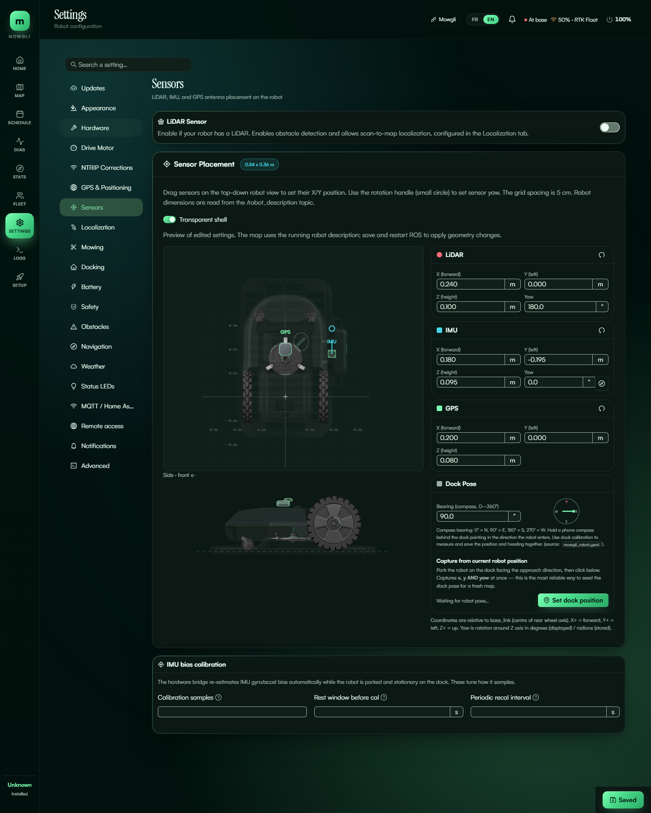 |

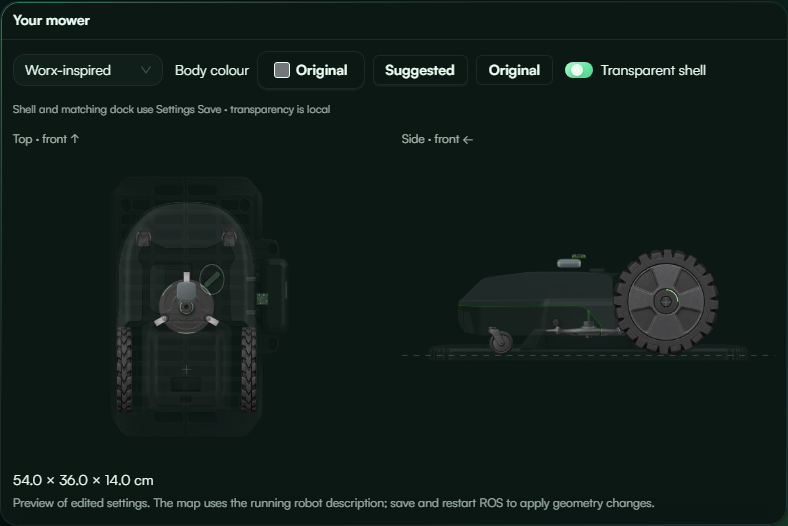
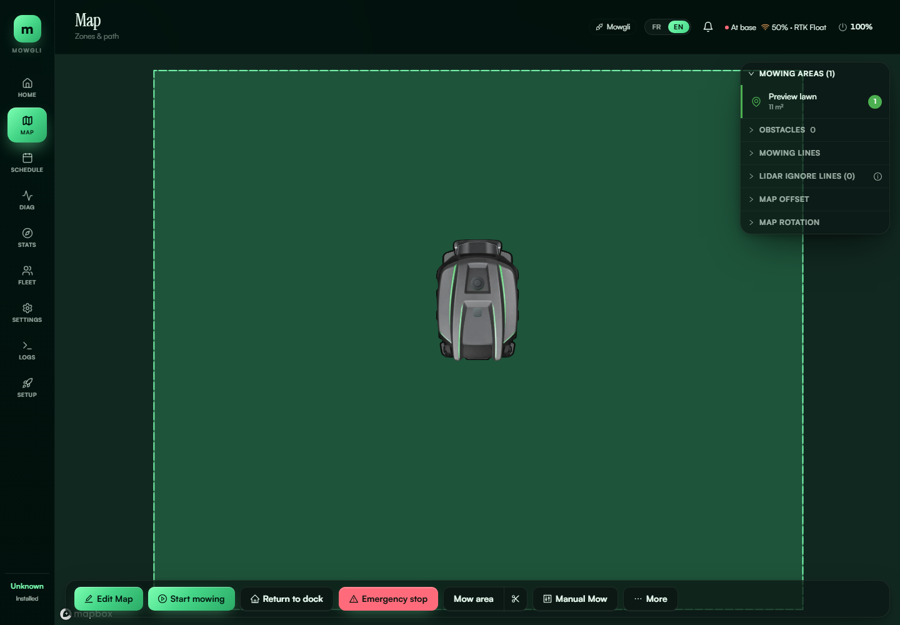
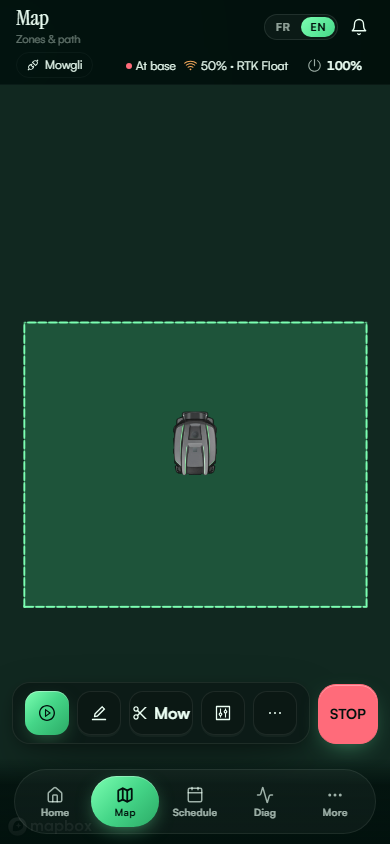

## Focused measurement editor

Implemented for 18 dimensional hardware fields. Desktop focus overlays the exact
endpoints, extension lines, arrows and value on the existing top or side preview.
The compact active preview stays above the fields while scrolling. Escape or
Close measurement dismisses it. Invalid input never labels a fallback preview as
the requested dimension.

On mobile, tapping a dimension opens a bottom-sheet dialog with the appropriate
projection, A/B endpoint labels, numeric input, units and the measurement help.
The sheet follows the visual viewport as the keyboard opens; its body scrolls
while Apply/Cancel remain accessible. The same dialog serves short touch screens.

**Apply** updates only the settings draft. **Cancel**, Escape and the close button
discard that dialog edit and restore focus to the field. Only the page's existing
**Save** persists changes. Invalid/out-of-range values disable Apply. No extra ROS
subscription, drive command, save or restart is introduced.

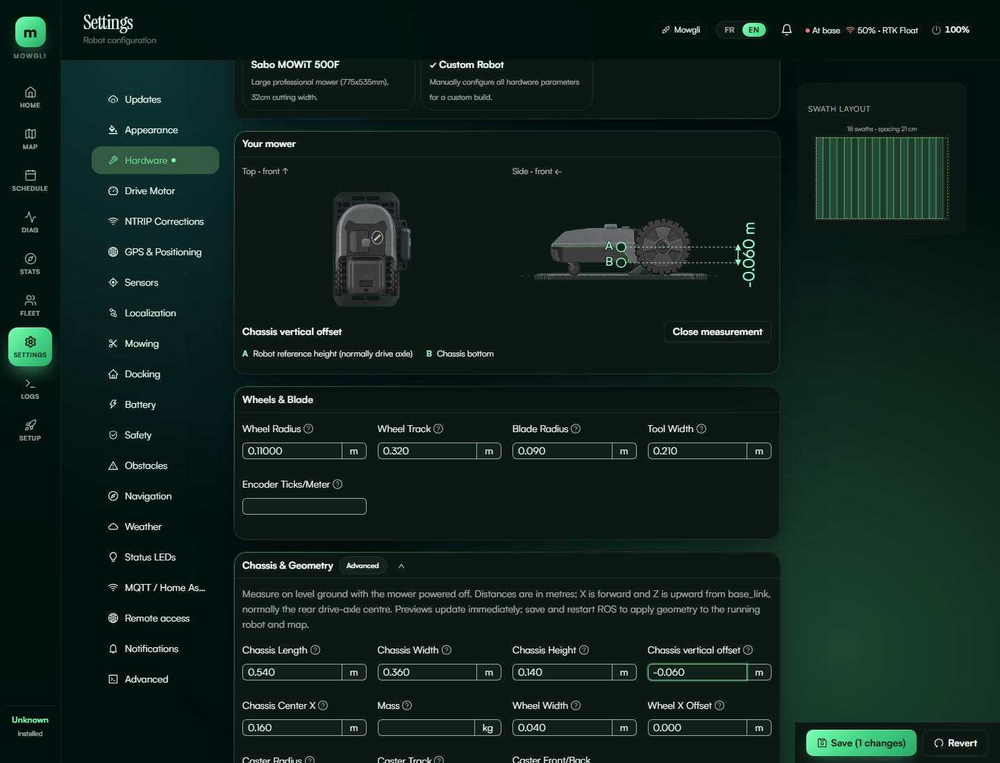
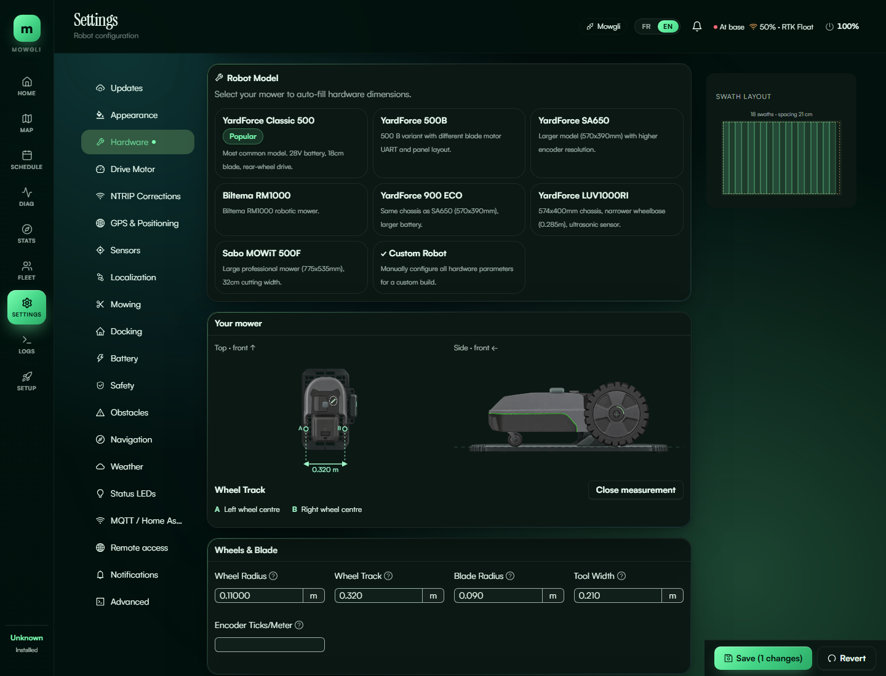


| Mobile side measurement | Mobile top measurement |
| --- | --- |
| 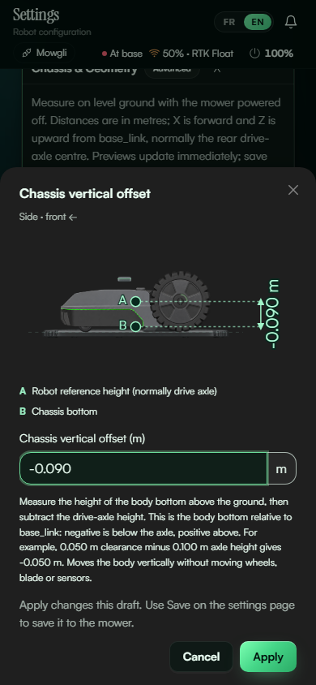 | 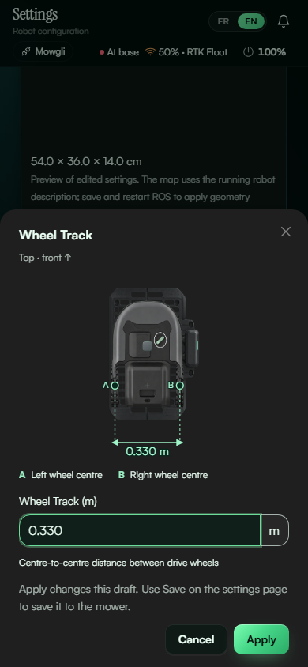 |

| Field | Projection | Measurement endpoints |
| --- | --- | --- |
| Chassis length / width | Top | Registered physical front/rear or left/right edges |
| Chassis height | Side | Shell bottom to top |
| Chassis bottom offset | Side | Rear axle height to shell bottom, signed |
| Chassis/caster front-back | Top or side | Rear axle line to chassis centre/caster axle |
| Wheel track | Top | Left wheel centre to right wheel centre |
| Wheel width | Top | Inner to outer tyre face |
| Wheel/caster radius | Side | Axle centre to tyre edge |
| Blade radius | Top | Disc centre to cutting envelope |
| Tool width | Top | Planned cutting swath, clearly distinct from disc radius |
| Dock length / width | Top | Complete registered footprint, including pedestal |
| Dock Center X / Y | Top | Built-in artwork reference to adjusted reference, signed |

A zero dock adjustment displays the built-in alignment correctly.
Changing numeric values updates the overlay immediately without saving or restarting
ROS. Sensor-specific dimensions can reuse the same interaction later. Mass and encoder counts keep their ordinary inputs because they have no spatial endpoints.

## Validation and limitations

Validation on 2026-10-11:
- Previous baseline a6c945e7: full frontend suite passed (973 tests, 119 files).
  Shared-configuration update: 46 focused appearance/rendering/locale tests pass.
  A broad rerun was stopped after excessive local runtime; no full-suite result is claimed for this update.
- TypeScript and lint pass (zero lint errors; existing warnings remain).
- 16 Hardware/Sensors/measurement/persistence browser cases and 9 map cases pass.
  Mobile checks cover Apply/Cancel/Escape, focus restoration, invalid input,
  viewport resizing and absence of automatic API writes.
- Production build verified before deployment.
- Current Go schema/default/generated-type and settings tests pass under Linux
  as a non-root user; configuration-drift check passes.
- Full ROS workspace build and physical geometry acceptance are not claimed.
  Browser mobile emulation is not a physical-phone/keyboard acceptance test.

Reproduce from gui/web using the repository's installed dependencies:

    npx tsc --noEmit
    npx vitest run src/components/robot src/utils/robotModel.test.ts src/hooks/useMowerVisual.test.tsx src/i18n/locales.test.ts
    npx playwright test tests/e2e/measurement-editor.spec.ts tests/e2e/layered-mower.spec.ts tests/e2e/layered-app-map.spec.ts tests/e2e/saved-mower-appearance.spec.ts --workers=2
    npx playwright test tests/e2e/layered-mower.spec.ts -g "Worx shallow" --workers=1

**HARDWARE_REQUIRED:** preset caster positions and chassis vertical offsets are
provisional physical geometry, not validated by artwork. Record the exact robot,
wheel type, running configuration, repository/URDF revision and firmware image.
With power off, blades removed and the mower stable on level ground, measure rear
axle-to-caster axle with casters forward, wheel centres/widths, and shell bottom/top
relative to the axle. Pass when configured geometry agrees within 5 mm; otherwise
use measured overrides and correct the preset. No motion is needed for this check.
See the component README for the existing Yardforce wheel-contour audit.
### Shared shell configuration

Body style and its matching dock are saved with Hardware settings in
`mower_visual_style`, shared across devices. Selection remains a draft until Save.
An empty setting follows the hardware model. Old browser shell preferences are
ignored rather than imported over mower configuration. Transparency remains a
local editing aid; Map always uses an opaque shell. Saving only appearance needs
no ROS restart. Regression coverage includes unsaved reload, save payload, a fresh
browser, Sensors and Map.


### Extensible artwork registry

All shell/dock choices, bilingual labels, pairings, source files, bounds, physical
frames, anchors, built-in offsets, map sizes and wheel layering now come from
`gui/web/src/components/robot/appearanceRegistry.ts`. Asset modules expose typed
views of that catalog; selectors and renderers do not repeat its ID lists.

To add an appearance, supply PNG artwork and registry metadata, then run
`npm run generate:appearances` in `gui/web`. It generates the backend shell enum
and compact map derivatives. Build checks validate image dimensions, atlas cells,
frames and references; tests enforce enum parity. A synthetic new shell/dock pair
is tested through resolution and both rendered views to catch hardcoded branches.
See the component README for the complete contributor workflow.

Registry cleanup validation: 7 registry/schema tests and 53 focused frontend
checks pass. All 29 browser checks (including four gallery captures) pass;
TypeScript and lint pass with zero errors and the unchanged warning baseline.
Existing compact assets regenerate byte-for-byte unchanged.


### Shared body colour

Hardware now offers a body-colour picker, each shell's suggested colour, and
**Original** to restore the grey artwork. All six shells have separate top/side
panel masks. The source shading, neutral highlights, black trim, controls and
mint details remain visible. `mower_visual_colour` is saved with Settings and
shared across browsers, Sensors and Map; it does not change geometry or request
ROS restart. Original remains the default.

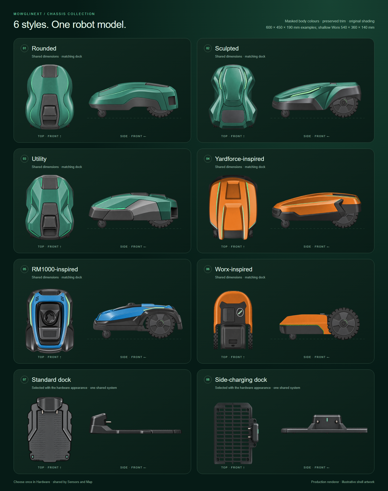
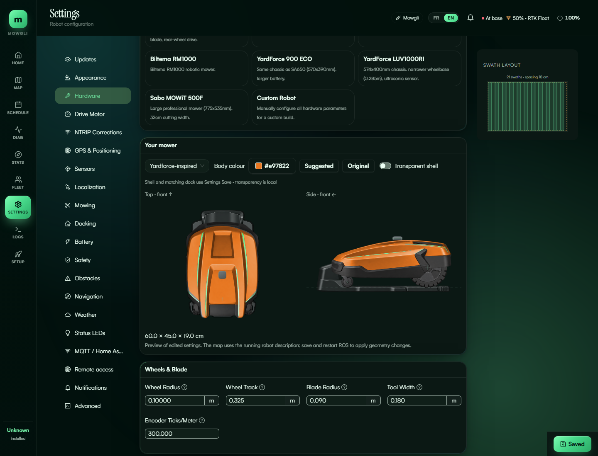
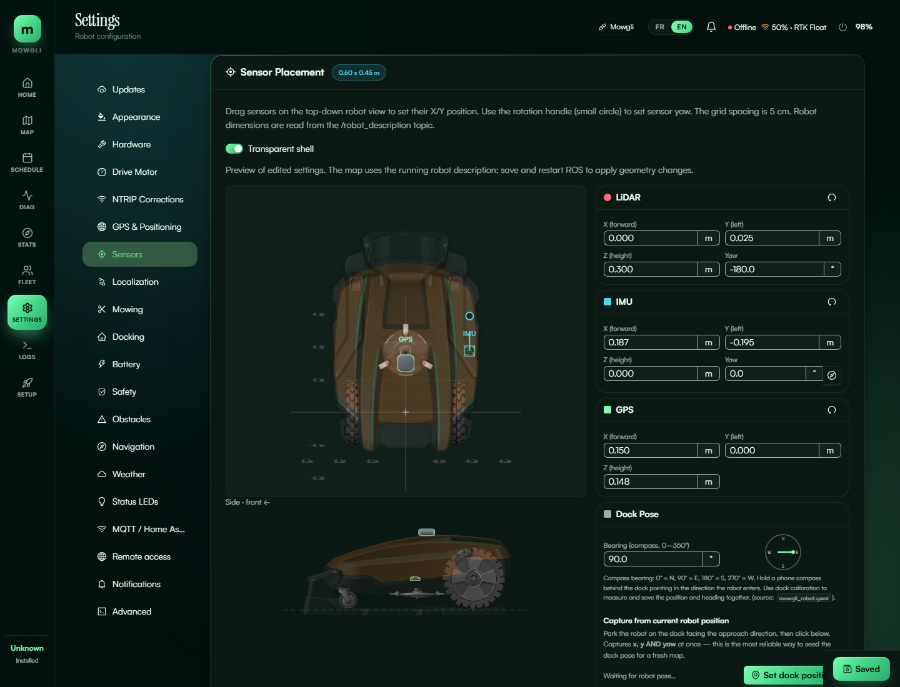
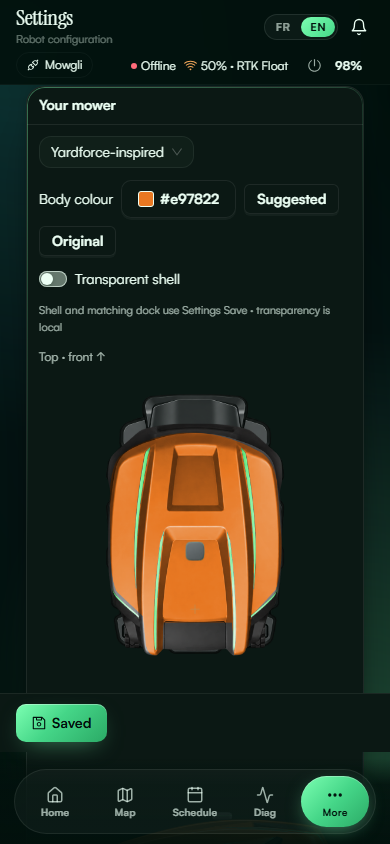

These are Chromium captures of the production renderer with mock telemetry.
The colour Hardware/Sensors example uses Yardforce 500 preset geometry, caster
X 0.40 m / track 0.30 m, GPS (0.15, 0, 0.148) m, and LiDAR disabled. The collection
uses the illustrative dimensions described above. Images are not physical-fit
validation. To reproduce: `playwright test tests/e2e/shell-colour.spec.ts` from
`gui/web`; files appear under `screenshots.local/layered-mower/pr/`.

Paint masks, suggested colours and filenames live in the appearance registry.
[New-shell and paint-mask instructions](../../../gui/web/src/components/robot/README.md#paintable-body-panels)
cover full-source coordinate registration, excluded panels and compact asset
generation. The twelve compact masks total about 100 KB. Map painting is cached
per appearance/colour at its existing 384 px limit; pose updates do not repaint.

Colour validation: 10 registry/schema tests, 53 focused frontend tests, and 32
browser cases passed, including saved colour across fresh browsers, draft reload,
Original reset, missing-mask fallback and compact map raster size. TypeScript and
lint pass (0 errors, the existing 900-warning ratchet unchanged). Go schema/default,
generated-type and settings tests pass in the non-root Linux build environment.


### Corrected side-charging dock profile

The separate side sprite now has a broad charging housing halfway along its tray,
with both charging contacts at the same height. The original top sprite, its map
asset, dock dimensions and registration offsets are unchanged. Galleries and Worx
Hardware/Sensors screenshots above have been refreshed. See the
[asset provenance and generation prompt](dock-side-artwork.md).

This artwork-only follow-up passed 10 registry tests, 43 robot-rendering unit tests,
three focused browser captures (Worx setup and both galleries), and touched-file lint.


### Side panel mask alignment

Rounded now paints the complete upper/main side panel down to the bumper seam,
excluding the lower skirt and control recesses. Yardforce's mask follows the lower
panel seam and angled black brace, with a separate exclusion for the rear recess.
This comparison uses the unchanged source PNGs and the production pixel pipeline:

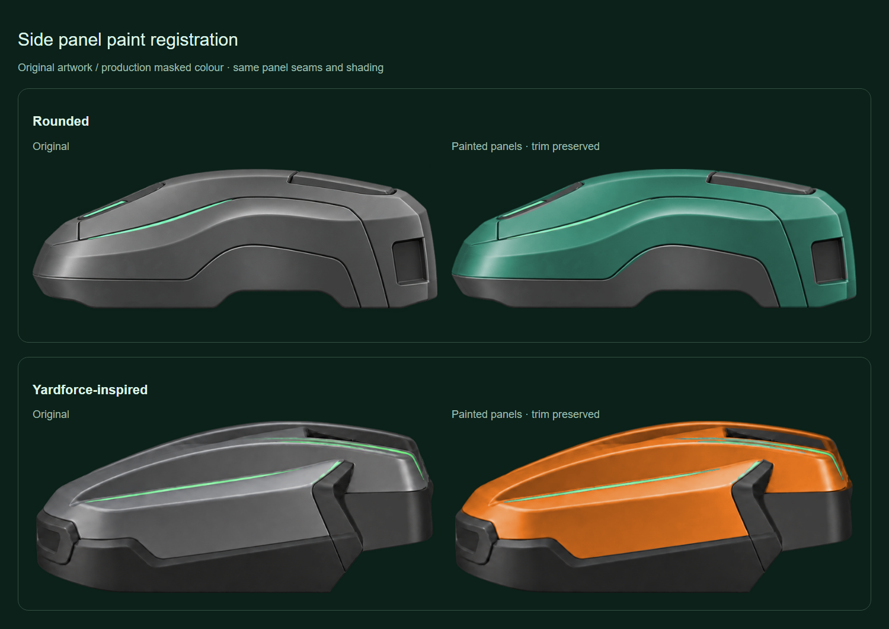

Reproduce with `playwright test tests/e2e/shell-colour.spec.ts`; the side review
fixture uses the registered physical frame so image padding is not part of the
comparison. All four colour browser cases passed; the colour-picker capture was
rerun after removing a redundant scroll during the mobile layout remount.


### Artwork updates and CI runner isolation

Artwork sources, paint masks and compact map assets now include the web-build ID
in their URLs. The GUI serves `/assets/` with a one-year immutable cache, so stable
filenames previously left browsers displaying older masks after a deployment.
A normal page reload now requests artwork belonging to the loaded web build.

The Node registry suite runs through `test:appearances` and is excluded from
Vitest discovery, avoiding Vite attempting to bundle `node:test`. The full local
CI test command passed 10 registry tests and 977 frontend tests after that fix;
both GitHub GUI CI jobs passed on commit `718595fb`. The subsequent artwork URL
change passed 45 focused unit tests, 13 browser cases and touched-file lint.
Browser coverage rejects unversioned artwork requests and verifies painting,
missing-mask fallback, shared appearance settings and desktop/mobile map views.


## Offset blade geometry

Hardware → Chassis & Geometry now includes **Blade Forward Offset** and **Blade Side Offset**.
These are signed metres from the chassis centre: positive forward / left, negative backward / right.
Zero preserves existing geometry, including custom chassis centres. Four decimal places retain
57.5 mm as `-0.0575` without rounding. The blade's X position is `chassis_center_x + blade_x_offset`.
For a chassis centre at X = 0.195 m, offsets (0, -0.0575) put the blade at (0.195, -0.0575),
independent of `wheel_x_offset`. The live URDF, previews and measurement endpoints agree.
The map continues to omit internal components. These offsets do not change blade radius or tool width.

Desktop uses the existing top-view overlay; mobile uses the same measurement dialog with Apply/Cancel.
The top shell is temporarily transparent while measuring the blade. Previously saved settings are not migrated.

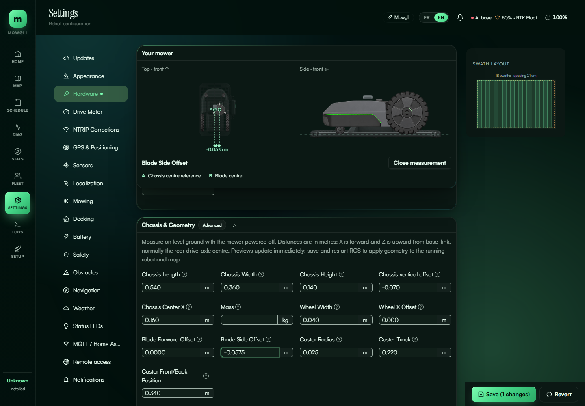
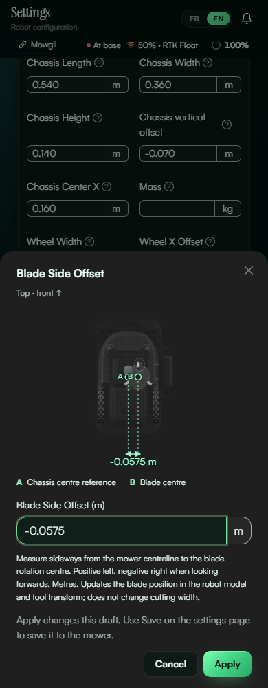

Physical acceptance: **HARDWARE_REQUIRED** for any off-centre robot. On the exact PR commit,
record the robot unit, firmware image and running ROS image/URDF. With power isolated and blades
removed, measure the blade rotation centre from the chassis centre; check the signed URDF
`blade_joint` X/Y against those measurements (within measurement uncertainty). Confirm zero offsets
retain the previous transform and that wheel/sensor transforms are unchanged. Navigation acceptance
for an asymmetric cutting tool requires a separate supervised field run; software tests alone do not
establish its coverage or edge-clearance behaviour.


## Upgrade compatibility review fixes

Sparse upgrades now inherit a missing chassis vertical offset from the selected
model preset. The GUI and ROS consume generated copies of the same preset data;
there is no separate 500/500B offset table. Explicit saved values, including zero,
continue to win. CUSTOM/unknown models retain the generic template fallback.
Caster placement still uses its existing chassis-derived fallback; other preset
settings are never replayed during an upgrade. This changes the URDF visual and
collision-box height when a newly introduced chassis offset was absent.

The retired map appearance preference is not migrated. Users of the earlier dev
build can reselect the new assembled RM1000 shell in Hardware. There is no static
image fallback, special RM1000 save/reset handling or migration state.

Validation: full Go API suite, 91 ROS/xacro and configuration-loader tests,
configuration-drift check, 36 focused frontend tests, registry validation and
TypeScript/production build passed. The full Go API suite also passed after
removing the migration. The geometry regressions cover sparse-template geometry and explicit overrides. These checks
run locally; they do not claim physical validation or installation on .118.


## Browser artwork alignment correction

Reproduced against PR #966 baseline `c152df8a51f3b11a331f4536162ce2a49b9ae82a`,
using mocked GUI settings and the repository robot-description fixture. No live
robot was used. Firefox displaced the nested image while the editor position
circle remained correct; LiDAR yaw changed the direction of the displacement.
Windows Playwright WebKit also lost the sensor raster through its SVG glow filter.

The shared shell/part viewport now uses source-pixel dimensions and a parent
transform to map into metres. Physical coordinates, crop registration and sensor
mounting rotations are unchanged. Putting this transform on the nested SVG itself
was rejected after the WebKit regression caught clipped/missing artwork. The
sensor highlight is now two translucent strokes without an SVG filter.

Verified on Playwright 1.62.1: Chromium 151.0.7922.34, Firefox 153.0 and WebKit 26.5
on Windows. All **48 browser cases passed**: four widths (390, 768, 1440, 2046),
four CSS scaling factors (0.8, 1, 1.25, 1.5), and three engines. Each checks actual
LiDAR/GPS/IMU pixels against the independently rendered position circle at LiDAR
yaw -90 and +45 degrees, requiring visibility and centre error below 1.75 pixels.
The highlight is hidden during isolation so it cannot pass for missing artwork.
The existing Hardware/map/saved-appearance suites also passed (20 cases).

This is CSS layout scaling, not actual browser-toolbar zoom; Windows Playwright
WebKit is not physical Safari/iOS acceptance. The high sensor mounting positions
below deliberately reproduce the reported geometry; they are not recommendations
for mounting sensors or evidence that a particular mower is physically calibrated.

Reproduce from `gui/web`:

```sh
npx playwright install chromium firefox webkit
npx playwright test --config playwright.robot-artwork.config.ts --workers=3
```

### Firefox after correction

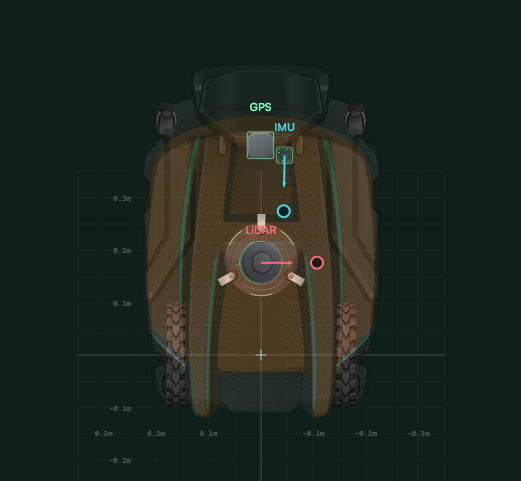

### WebKit after correction

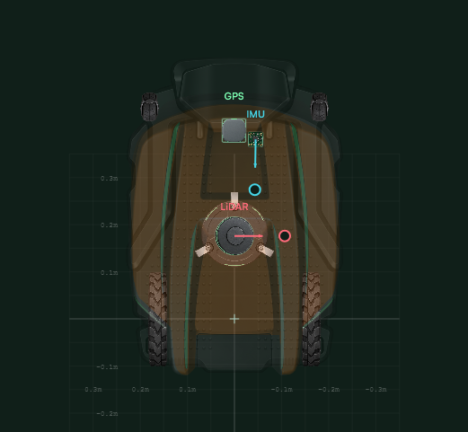

### Chromium reference

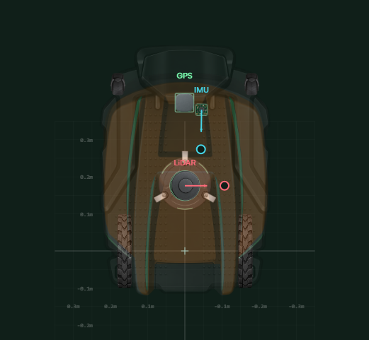


## Preset-backed chassis height on upgrade

`gui/web/src/constants/mowerModels.ts` remains the authored preset source. Run
`npm run generate:model-geometry` from `gui/web` after changing its opted-in
upgrade fields. The generator emits identical `model_geometry_defaults.json`
assets for the GUI and ROS images; the Go asset parity test (`go test ./...` in GUI CI) rejects stale data.
Only `chassis_z_offset` is opted in. This is not an automatic reapplication of
wheel dimensions, sensor mounts, calibration, charging settings or the full preset.

The read/default/reset/save paths and ROS config merge use the selected preset.
Missing model selection follows the existing template model; CUSTOM, unknown
models and presets without this key keep the generic fallback. Explicit offsets
(including zero) win and survive unrelated saves. No configuration file is
rewritten merely by reading it. Selecting a different model in the form updates
its reset-to-default value before Save; late responses for an old choice are ignored.
GUI and ROS must both contain this change for the preview and running URDF to agree.

The current Yardforce 500/500B presets supply -0.050 m: with their 0.100 m wheel
radius and 0.190 m shell height, estimated ground clearance is 0.050 m and shell
top is 0.240 m. This remains photo-estimated, not a new hardware measurement.
**Safety-critical geometry:** the URDF visual and collision box both move down;
wheel, sensor and blade frames and the 2D footprint do not move.

**HARDWARE_REQUIRED:** baseline is this PR's preset-generated upgrade implementation,
YardForce500/B model, wheel_radius=0.100, chassis_height=0.190, chassis_z_offset=-0.050.
No robot or firmware was changed in this verification. On the intended physical
unit, powered off with blades removed and secured on level ground, measure ground
to the lowest body skirt and highest shell point. Accept this provisional fit only
if those readings are within 5 mm of 50 mm and 240 mm; otherwise save measured
height/offset overrides and record the unit, repository/URDF revision and firmware.
