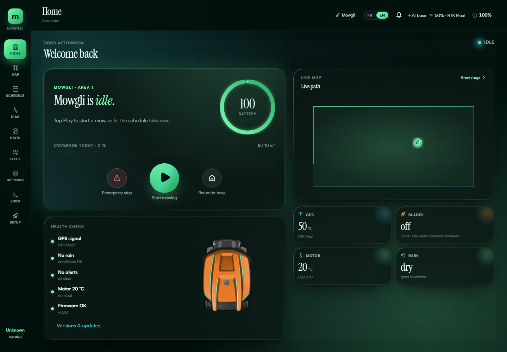
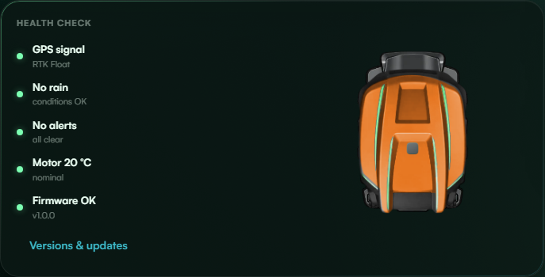
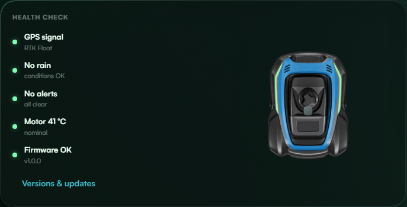
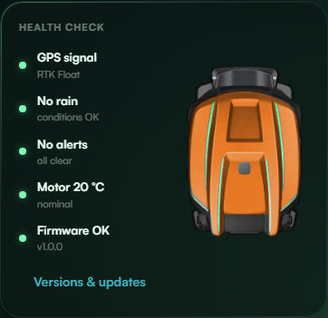
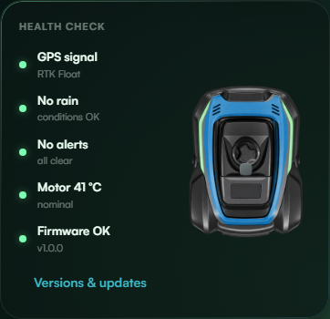
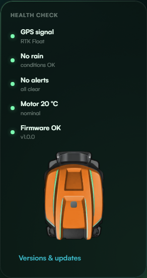

# Configured mower in the dashboard Health Check card

This follow-up requires upstream PR #966. It starts from that PR's
`d7c33aff4a0222552ceea3522c4cbe0066cab407` revision and adds dashboard UI only.

The card shows the configured shell and colour, rear wheels, GPS and enabled
LiDAR in top view. Geometry comes from the running robot description. Until a
supported description arrives, the existing health rows use the full card width.
The body is always opaque; the sensor editor's transparent-shell setting does
not affect this view. The paired dock respects the saved display dimensions and
registration offsets from #966.

Dock presence follows `Power.charger_enabled`, falling back to `Status.is_charging`
and then `HighLevelStatus.is_charging` only when the preceding field is absent.
These are the existing contact/charging indications, including a full docked
battery. No dock is inferred from `IDLE_DOCKED`, charge current or map proximity.
The existing connection state hides the dock while disconnected. This is a
telemetry illustration, not an independent physical-contact detector.

Compact map artwork and existing paint caches are reused. No new image files,
pose stream, command, configuration write or robot-side component is introduced;
the dashboard adds the shared robot-description subscription. The frame stays
fixed when contact changes so the mower does not jump in size while undocking.

## Screenshots

Real Chromium app renders with mocked telemetry and the existing processed-URDF
fixture, not live mower/location captures or a physical-dimensions validation.
The docked Yardforce uses orange, and the mowing RM1000 uses blue; LiDAR is disabled
in these examples. The 320 px layout stacks the illustration below the health rows.



| Docked | Mowing |
| --- | --- |
|  |  |
|  |  |



## Reproduce

From `gui/web`, run:

```sh
npx playwright test tests/e2e/status-mower.spec.ts tests/e2e/dashboard-dock.spec.ts --workers=2
npx vitest run src/components/dashboard src/i18n/locales.test.ts
npm run build
```

The browser suite covers docked/full/zero-current and mowing renders, disabled
LiDAR, opaque shells despite the saved editor preference, compact versioned asset
requests, absent telemetry, explicit false contact overriding an old high-level
charging value, and no configuration/command writes. Component tests cover side
dock pairing, unchanged scale across undocking, disconnection and unavailable URDF.
Screenshots regenerate under `gui/web/screenshots.local/status-mower/`.
