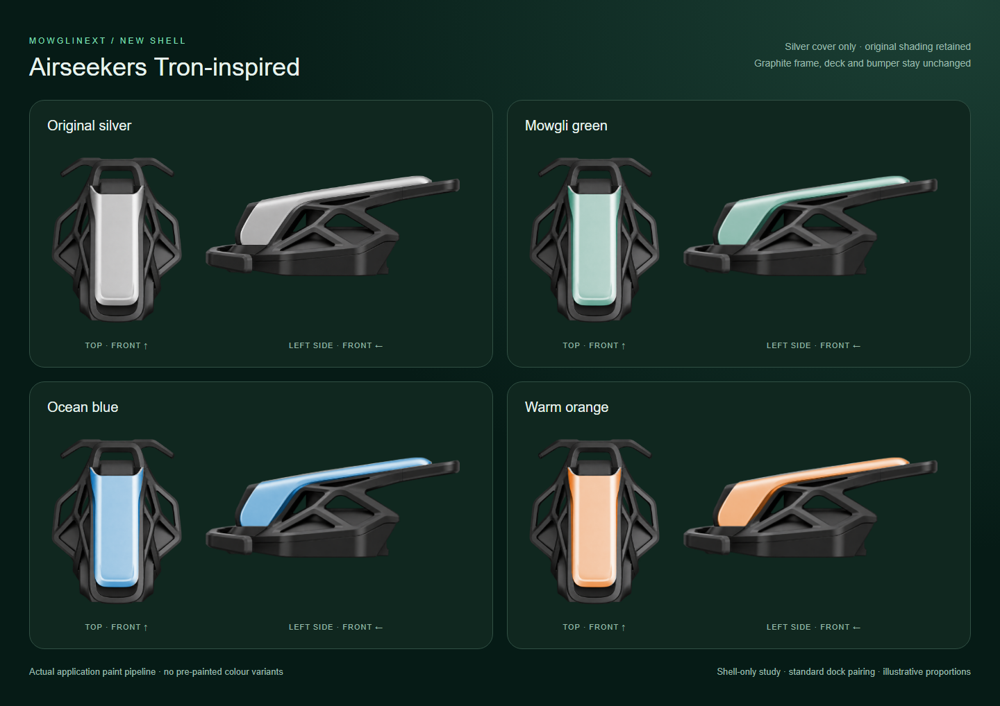
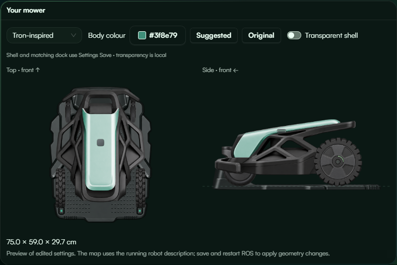
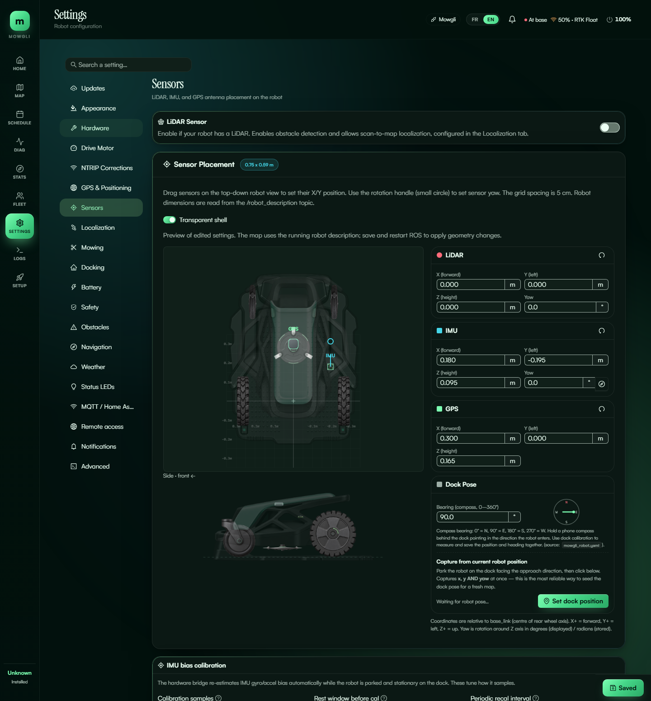

# Airseekers Tron-inspired shell

Depends on visual PR #966 at `c152df8a51f3b11a331f4536162ce2a49b9ae82a`.
Adds one registry entry and its artwork; existing selectors, saved appearance,
transparent editor mode and map rendering discover it automatically. The paired
dock is the existing standard dock. No new hardware preset or physical dimensions
are applied, and no firmware, control, planning or drivetrain behavior changes.

## Colour proof

Only the silver upper cover is masked. The source's neutral highlights remain,
so bright silver produces a lighter tint than the existing graphite shells.
The black frame, deck, bumper and open cutouts retain their original appearance.
The source/masks are identical in solid and transparent views.

These screenshots use the real React components and canvas paint pipeline with
mocked robot data. Colour study hides independent wheels/sensors for inspection.
Hardware/Sensors use the ordinary configurable wheels/casters, not a simulation
of Tron's front omni wheels. The illustrative 750 × 590 × 297 mm chassis and
wheel/sensor values are screenshot fixtures only, not measured dimensions or a
preset. They are never applied by selecting this shell. No robot was accessed.

The revised example places the chassis bottom 70 mm below the rear axle, giving
60 mm ground clearance with its 130 mm wheel radius. This lowers the body 35 mm
from the first screenshot without changing its height or wheel dimensions. The
illustrative GPS mounting height moves down with the shell. This is a visual
fit to the supplied reference, not a measured Tron specification.

## Artwork provenance and registration

Built-in ImageGen generated `tron.png` using the user's three Tron photos as shape
references and the existing Yardforce atlas as the material/layout reference.
No reference photographs, brand logos or text are shipped. The native PNG is
2059 × 764 with true alpha. Its alpha >220 bounds are:

| Projection | X | Y | Width | Height |
| --- | ---: | ---: | ---: | ---: |
| Top (front up) | 136 | 32 | 553 | 702 |
| Left side (front left) | 865 | 204 | 1111 | 440 |

These bounds, excluding padding, determine scaling to configured chassis geometry.
The side frame includes the rear upper overhang. The SVG paint masks use the same
2059 × 764 **width, height and viewBox**, with traced paths restricted to the cover.
Source PNG pixels were not manually recoloured. The existing renderer applies the
chosen pigment and retains source luminance/alpha. Map derivatives use the existing
Chromium crop/resize pipeline: two WebPs and two masks total 45,598 bytes, max 384 px.

### Generation prompt

Create one production sprite atlas for a layered robot mower UI, Airseekers
Tron-inspired body only. Use supplied top, left-side and three-quarter photos as
exact design references, existing Yardforce sprite atlas for UI materials/layout.
Wide atlas: true orthographic top, front up, on left; true orthographic left-side
elevation, front left, on right. Same chassis in both views. Preserve long narrow
silver upper spine with rounded rear end, graphite open triangular exoskeleton,
broad faceted lower deck and front U-shaped bumper. Keep transparent side-frame
voids and rear wheel clearance. Satin mid-light neutral silver upper panel with
crisp boundary for an SVG mask, nearly black frame/deck/bumper and subtle mint
details. Omit wheels, tyres, hubs, axles, casters, front omni wheels, sensors,
cameras, pods, stop buttons, logos and text. Keep narrower rear deck and broad
middle wings. Side upper cover slopes down around the front and rises gently
toward its rear overhang above the open truss. Complete isolated transparent
parts; no floor, external shadow, labels, perspective or invented car styling.

## Validation

Browser regressions cover both projected alpha bounds, full/map-resolution painted
pixels (not only a successful image load), standard dock pairing, disabled LiDAR,
and unchanged artwork under the transparency toggle. The inherited missing-mask
test now derives its count from the registry instead of assuming six shells.
Production build and focused checks passed; final full-suite results are recorded
in the PR description.
